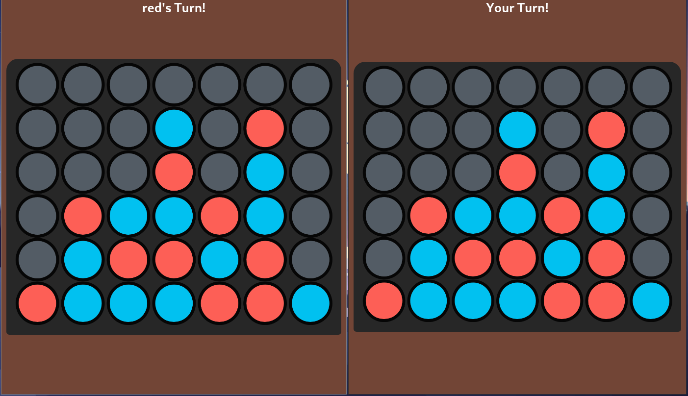

# Chess

Very simple Connect Four game for playing with another player over a local network.


# Screenshot



## Setup

### 1. Clone the project

```bash
git clone --depth 1 https://github.com/s2sadeghi/4connect.git
cd chess
```

### 2. Run

#### using UV

```bash
uv sync

uv run python app.py
```

#### or with pip

Install dependencies:
```bash
virtualenv .venv
source .venv/bin/activate
pip install -r requirements.txt

python app.py
```

### 3. Open the website

Open your browser and go to:

```text
http://localhost:8000
```